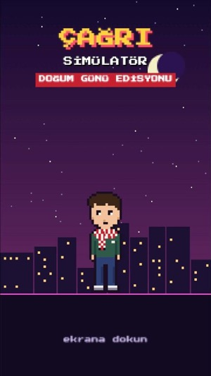
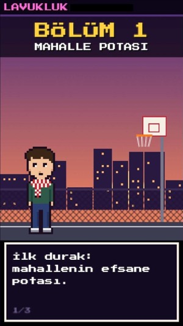
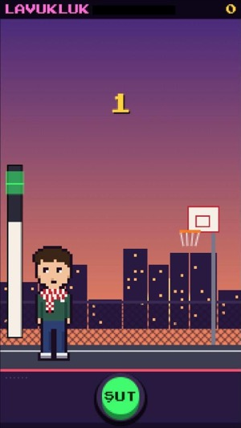

# Çağrı Simülatör

Çağrı'nın doğum günü için dikey, pixel-art bir ritim oyunu. Üç bölüm: Mahalle Potası (yeşil şut zamanlaması), Duman Kralı (Dumancı Baba'ya karşı) ve Son Şarkı.

  
  
  

## Oyna

- **Web / iPhone / Android tarayıcı:** https://kimahmet.github.io/cagri-simulator/
- **iPhone'da uygulama gibi:** Safari'de linki aç → Paylaş → **Ana Ekrana Ekle**. Tam ekran, ikonlu açılır.
- **Android APK:** [Releases](https://github.com/kimahmet/cagri-simulator/releases/latest) sayfasından `cagri-simulator.apk` indir, kur (bilinmeyen kaynaklara izin ver).

## Kontroller

- 1. bölüm: ekrana ya da yeşil ŞUT tuşuna, metre yeşildeyken bas.
- 2. ve 3. bölüm: notalar çizgiye gelince alttaki 3 tuşa bas. Klavyede A S D.

## Geliştirme

Oyunun tamamı `www/index.html` içinde. Kaydet, `main`'e pushla:

- `pages.yml` web sürümünü GitHub Pages'e yayınlar.
- `android.yml` Capacitor ile APK derler ve `latest` release'ine koyar.

İkonları yeniden üretmek için: `npm run icons`.
